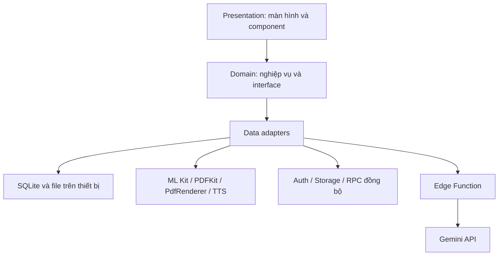
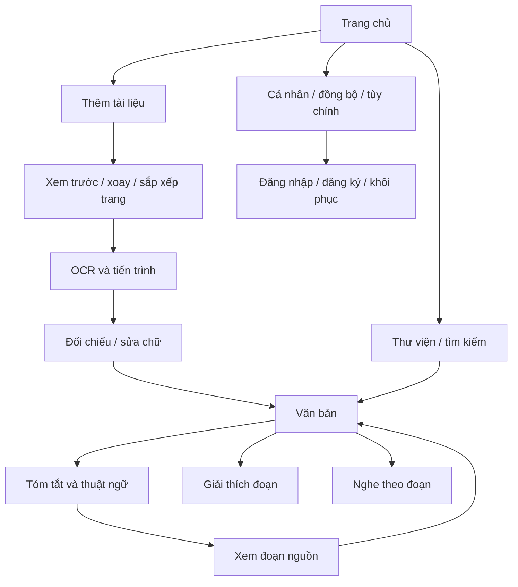

# BÁO CÁO 1 — Đề xuất đề tài và wireframe tương tác

**Đề tài:** LearnAccess — Ứng dụng chuyển đổi tài liệu học tập thành nội dung dễ tiếp cận bằng AI.  
**Học phần:** Phát triển ứng dụng di động đa nền tảng.  
**Nhóm:** LearningAccess.  
**Nhóm trưởng:** Hoàng Văn Đạt — 23IT.B037.  
**Giảng viên hướng dẫn:** TS. Nguyễn Thanh Tuấn.  
**Học kỳ:** 1, năm học 2026–2027. Hạn Report 1: tuần 4 học phần.

## Bài toán và người dùng

Sinh viên thường học từ ảnh chụp hoặc PDF scan không có lớp văn bản, khó tìm kiếm và khó nghe lại. LearnAccess kết hợp số hóa, kiểm tra nội dung, tóm tắt và đọc bằng giọng nói trong một quy trình. Giá trị khác biệt là giảm thao tác chuyển ứng dụng, hỗ trợ học lại offline và cho phép kiểm tra từng ý AI với nguồn tài liệu.

Người dùng chính: Nguyễn Minh Tuấn, sinh viên 21 tuổi, tranh thủ 45 phút đi xe buýt để học. Tuấn cần số hóa giáo trình và nghe lại khi mạng không ổn định. Nhóm người dùng bổ sung là sinh viên cần cỡ chữ lớn hoặc công cụ hỗ trợ đọc. Mức độ đáp ứng nhu cầu tiếp cận phải được đánh giá bằng kiểm thử người dùng, chưa khẳng định hiệu quả lâm sàng với dyslexia hoặc đáp ứng toàn bộ nhu cầu khiếm thị.

**User story:** Tôi muốn chụp/nhập tài liệu, kiểm tra chữ được nhận diện, tạo bản tóm tắt có nguồn và nghe nội dung đã lưu ngay cả khi mất mạng.

Không đưa các nhận định tuyệt đối về đối thủ vào báo cáo khi chưa có khảo sát có ngày và nguồn kiểm chứng.

## Phạm vi

| Mức         | Chức năng                                                         |
| ----------- | ----------------------------------------------------------------- |
| Must-Have   | Nhập ảnh/PDF, OCR, sửa chữ, thư viện, lưu cục bộ, đọc lại offline |
| Must-Have   | Đăng nhập email, hồ sơ, AI tóm tắt/diễn giải có nguồn, TTS        |
| Should-Have | Đồng bộ có hàng đợi, Google OAuth, Dark Mode, tùy chỉnh đọc       |
| Could-Have  | Quiz, flashcards                                                  |

Giới hạn đầu vào: 5 trang, 20 MB/file; chữ in tiếng Việt/Anh. AI tối đa 30.000 ký tự mỗi lần, cần mạng. Mở nội dung và bản tóm tắt đã lưu không cần mạng. OCR offline cần native build chứa mô hình; TTS offline cần giọng có sẵn trên máy.

## Công nghệ thống nhất

React Native + Expo Router + TypeScript; React Native Paper/Material 3; Zustand; TanStack Query; SQLite + Drizzle ORM; Supabase Auth/PostgreSQL/Storage/Edge Functions; ML Kit; Gemini; expo-speech; GitHub Actions + Expo Build. Không dùng Drift hoặc flutter_tts.

## Wireframe và tương tác

Prototype tương tác chính là các màn hình Expo trong `src/app/`; có thể xem bố cục bằng `npm run web`. Chức năng native dùng development build; dữ liệu thật không được thay bằng kết quả AI/OCR giả.

Các trạng thái phải thể hiện: quyền bị từ chối; PDF lỗi/quá giới hạn; OCR không có chữ; hủy và retry; AI mất mạng hoặc vượt lượt; bản tóm tắt cũ sau sửa chữ; dữ liệu pending sync; xung đột tạo bản sao.

## Tiêu chí đánh giá

Đo CER trên tài liệu in rõ; đánh giá nguồn AI bằng đối chiếu thủ công; kiểm tra tắt/mở app khi offline; thử hai tài khoản và hai thiết bị; kiểm tra cỡ chữ lớn, VoiceOver/TalkBack; chạy luồng demo lặp lại trên Android/iPhone. Các con số mục tiêu không được trình bày như kết quả đo nếu chưa thực nghiệm.
